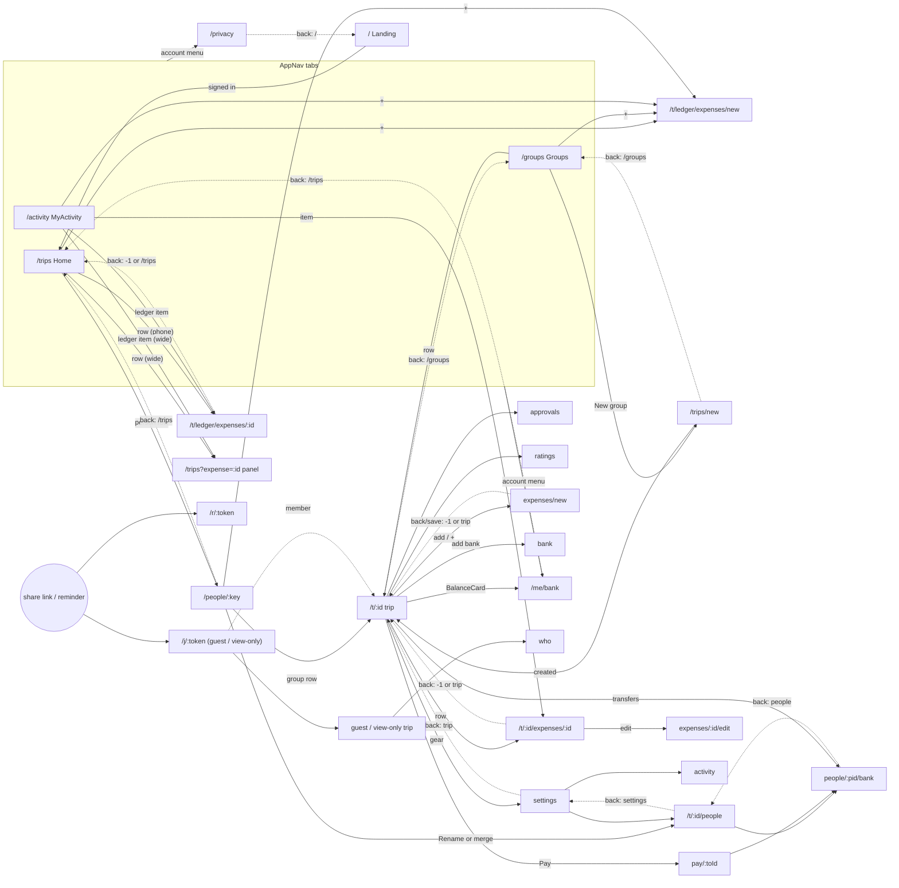

# CoinCrew web: navigation map

Audit of every route and navigation path in `apps/web/src` (React Router v7, `App.tsx`). Written 2026-10-31 on
branch `feat/no-group-expenses`, **including the uncommitted working-tree changes** (CreateTrip back `/groups`,
People `?from=`, PersonScreen "Rename or merge" link). Updated 2026-11-01 after the back-navigation work: §3 and §6
describe the code now, §4 keeps the audit with an outcome column, and line numbers in §1-§2 are from the audit.
All paths below are relative to `apps/web/src/`.

Terms:

- **Phone** = below 1024px, **wide** = from 1024px (`lib/media.ts:25`, `useIsWide`).
- **Member** = trip under `/t/:tripId`; **guest / view-only** = trip under `/j/:token` (`lib/tripBase.tsx`).
- **Ledger** = the hidden trip with `preset === 'direct'` that holds quick expenses. It has no page of its own.
- **Push / replace** = a new history entry / the current entry is overwritten.

---

## 1. Route table

42 route patterns in all: 9 top-level, 16 under `/t/:tripId`, 17 under `/j/:token` (the same 16 plus `e/:expenseId`).
There is **no catch-all `*` route**: an unknown path renders only `<AuthNotice />` (a blank page).
`screens/Placeholder.tsx` is imported in `App.tsx:2` but not routed.

### Top level

| Route | Component | Shows | Tab (AppNav) |
|---|---|---|---|
| `/` | `Landing` | Sign-in start page; a signed-in user is replaced to `/trips` (`Landing.tsx:27-31`) | no |
| `/trips` | `TripsRoute` -> `Home` (`App.tsx:23-30`) | Home: totals, "by person" list, the ledger's expenses/payments. Wide: ledger details in the right column via `?expense=` / `?payment=` / `?income=` | **home** |
| `/trips?mergeReview=…` or `?tab=groups` | `TripsRoute` -> `<Navigate to="/groups" + search replace>` (`App.tsx:26-27`) | redirect | - |
| `/groups` | `Groups` -> `MyTrips embedded` | Group list, "New group", merge-request banner (`?mergeReview=` is consumed and dropped, `MyTrips.tsx:44-52`) | **groups** |
| `/activity` | `MyActivity` | The user's activity across groups and the ledger | **activity** |
| `/trips/new` | `CreateTrip` | Create-group form | no |
| `/people/:key` | `PersonScreen` | One person across groups: total, per-group rows, merge, settle, request | no (nav shown, section `home`) |
| `/r/:token` | `RequestPage` | Public payment-request page (sent to the debtor) | no |
| `/privacy` | `Privacy` | Privacy policy | no |
| `/me/bank` | `BankDetails` (no trip) | The user's own bank details | no |
| `/t/:tripId/*` | (no element; `tripPages`) | Member trip pages, see below | - |
| `/j/:token/*` | `Join` (resolves token, `TripBaseProvider`, `<Outlet/>`) | Guest / view-only trip pages, see below | - |
| `/j/:token/e/:expenseId` | `OldExpenseLink` -> `<Navigate to="/j/:token/expenses/:id" replace>` (`Join.tsx:66-69`) | redirect (reminder and shared-bill links, `lib/remind.ts:93-97`) | - |

AppNav (`components/AppNav.tsx:23-27`): `home` `/trips`, `groups` `/groups`, `activity` `/activity`, plus a "+" whose
`addHref` each screen passes. Screens that render it: Home (`home`), Groups (`groups`), MyActivity (`activity`),
PersonScreen (`home`), MemberTrip (`groups`, signed in), ViewOnlyTrip (`groups`, signed in), TripRoute FORBIDDEN error
(`groups`). On phones it is a floating footer; from 1024px a left side panel that also holds the account menu.

### Trip pages (`tripPages`, mounted at both `/t/:tripId` and `/j/:token`)

| Child path | Component | Shows (phone / wide) |
|---|---|---|
| (index) | `TripRoute` | `MemberTrip` / `GuestTrip` / `ViewOnlyTrip` by `view.me.kind` |
| `expenses/:expenseId` | `TripRoute` | Phone: `DetailsPage` (own page). Wide: trip page + `DetailsPanel` right column |
| `payments/:paymentId` | `TripRoute` | same |
| `fund/:incomeId` | `TripRoute` | same (fund income) |
| `approvals` | `TripRoute` | Phone: `Approvals` page. Wide: trip page + panel. Non-members redirected to trip |
| `ratings` | `TripRoute` | Phone: `RatingsScreen` page. Wide: trip page + `RatingsPanel`. Redirected to trip unless sport preset with ratings on |
| `who` | `WhoAreYou` | Guest name picker / join |
| `expenses/new` | `ExpenseForm` | Add expense (`?type=income` = add fund income via `IncomeForm`) |
| `expenses/:expenseId/edit` | `ExpenseForm` | Edit expense |
| `fund/:incomeId/edit` | `ExpenseForm` -> `IncomeForm` | Edit fund income |
| `pay/:toId` | `PayScreen` | Pay one person (QR, bank apps) |
| `bank` | `BankDetails` (trip) | Own bank details for this trip |
| `people` | `People` | Manage the group's people (rename, merge, remove, admin, bank) |
| `people/:pid/bank` | `GuestBank` | Bank details a member keeps for a non-member |
| `activity` | `Activity` | The group's activity log |
| `settings` | `Settings` | Group settings (people, activity, archive, leave) |

Redirects inside `TripRoute` (`screens/TripRoute.tsx`), all `replace`:

| Line | Condition | Goes to |
|---|---|---|
| 116-120 | guest without a picked name | `<base>/who?next=<current path+search>` |
| 162-164 | member on `/j/…` | `/t/<tripId><rest>` |
| 165-168 | non-member on `/t/…` with a saved link token | `/j/<token><rest>` |
| 170-172 | ledger, no selection | `/trips` |
| 175-177 | ledger, organiser, wide, a transaction selected | `/trips?<kind>=<id>` (`homeDetailsHref`) |
| 180-182 | `approvals` for a non-member | trip page |
| 185-187 | `ratings` when not enabled | trip page |

Other redirects: `Home.tsx:69-73`, `MyTrips.tsx:60-64`, `MyActivity.tsx:32`, `CreateTrip.tsx:31-35` replace a
signed-out visitor to `/`; `Home.tsx:76-79` replaces `/trips?<kind>=<id>` on a phone with
`/t/<ledger>/<segment>/<id>` (`ledgerDetailsPath`); `GuestBank.tsx:71-73` replaces to the trip when the person is not
a non-member or the caller is not a member; `WhoAreYou.tsx:231-233` replaces a signed-in member to `target`;
`AuthNotice.tsx:26` strips `?auth/linked/merge/provider` with replace.

---

## 2. Entry points per route

(`L` = `<Link to>`, `B` = `<Button href>` (in-app `Link`), `N` = `navigate()`, `R` = `<Navigate>`, `X` = full page
load / external.)

| Route | Entry points |
|---|---|
| `/` | X: typed / first visit. N: sign-out `AccountMenu.tsx:112`; leave group `Settings.tsx:78` (push); signed-out guards (replace) Home:71, MyTrips:62, MyActivity:32, CreateTrip:33. L: Privacy back `Privacy.tsx:11`. B: `Placeholder.tsx:12` (unrouted) |
| `/trips` | L: AppNav home `AppNav.tsx:24` (footer :47, side :99). N: Landing signed-in `Landing.tsx:29` (replace). X: OAuth return `Landing.tsx:59` (`returnTo="/trips"`). R: ledger trip `TripRoute.tsx:171`. Fallbacks: `useBackToTrip(…, '/trips')` `TripRoute.tsx:47`, `useLeaveForm(…, '/trips')` `ExpenseForm.tsx:1548`. L back: PersonScreen `PersonScreen.tsx:96,104,112,262`; `/me/bank` `BankDetails.tsx:63`. Default `addHref` when no ledger: Groups:16, MyActivity:35, PersonScreen:52, ViewOnlyTrip:31, MemberTrip:46, TripRoute:136 |
| `/trips?<kind>=<id>` | L: MyActivity, ledger items on wide `MyActivity.tsx:66-70,98-99`. R: `TripRoute.tsx:176`. Home's own `setSearchParams` (replace) `Home.tsx:53-56` |
| `/groups` | L: AppNav groups `AppNav.tsx:25`. L back: MemberTrip `MemberTrip.tsx:131`, CreateTrip `CreateTrip.tsx:113`. R: TripsRoute `App.tsx:27`. X: OAuth return `MergeSheet.tsx:248` (`/groups?mergeReview=<id>`) |
| `/activity` | L: AppNav activity `AppNav.tsx:26` only |
| `/trips/new` | B: MyTrips "New group" `MyTrips.tsx:79` and empty state `MyTrips.tsx:98` |
| `/people/:key` | L: Home person row `Home.tsx:113-115`. N: after merge `PersonScreen.tsx:164` (replace) |
| `/r/:token` | X only: URL from `requestLink()` shared/copied in `PersonScreen.tsx` (`handleRequestLink`, ~l.222-238) |
| `/privacy` | L: AccountMenu `AccountMenu.tsx:336`; ConsentSheet `ConsentSheet.tsx:40` (on Home, Groups, CreateTrip); Landing `Landing.tsx:86`; BankDetails `BankDetails.tsx:211`; GuestBank `GuestBank.tsx:221` |
| `/me/bank` | L: AccountMenu `AccountMenu.tsx:317`; BalanceCard "add bank" prompt on a member trip `BalanceCard.tsx:106-107` |
| `<base>` (trip page) | L: MyTrips row `MyTrips.tsx:121-123`; PersonScreen group row `PersonScreen.tsx:383-385`. N: after create `CreateTrip.tsx:59` (push); after archive/unarchive `Settings.tsx:62` (push); WhoAreYou `target` default `WhoAreYou.tsx:137,154` (push). L back: Settings `Settings.tsx:34,44,86`; PayScreen `PayScreen.tsx:164,178,393`; BankDetails (trip) `BankDetails.tsx:63`. B: PayScreen "Back to trip" `PayScreen.tsx:223`, "Back" `PayScreen.tsx:280`. Fallbacks (replace): `useBackToTrip` / `useLeaveForm` `lib/detailsNav.ts:61,77`. R: TripRoute :181,:186, GuestBank :72. X: invite links `/j/<token>` `InviteSheet.tsx:137-162`, `lib/remind.ts:90` (`groupLink`); OAuth returns `GuestTrip.tsx:148` (`?becomeMember=1`), `NoAccess` `TripRoute.tsx:143` |
| `<base>/expenses/:id` | N: `useOpenDetails` (push, `state.fromList`) `lib/detailsNav.ts:24-35`, called from list rows via `useDetailsSelection` `DetailsPanel.tsx:98-112` (MemberTrip/GuestTrip/ViewOnlyTrip), Home phone `Home.tsx:101-104`, ApprovalsCard `ApprovalsCard.tsx:41`. L: MyActivity (non-ledger, or ledger on phone) `MyActivity.tsx:66-67,98` (no state). N: sport expense created `ExpenseForm.tsx:665` (replace, no state); rollback `ExpenseHistoryList.tsx:57` (replace, no state). R: Home phone redirect `Home.tsx:78` (replace, no state); OldExpenseLink `Join.tsx:68`. X: shared expense link `lib/remind.ts:93-97` |
| `<base>/payments/:id` | N: `useOpenDetails` from rows; ApprovalsCard `ApprovalsCard.tsx:197`. L: MyActivity `MyActivity.tsx:68-69`. R: Home phone `Home.tsx:78` |
| `<base>/fund/:id` | N: `useOpenDetails` from income rows (`onOpenIncome`) |
| `<base>/approvals` | L: ApprovalQueue "See all" `ApprovalQueue.tsx:29,107` (`useApprovalsLink`, push + `fromList`, replace when switching on wide) |
| `<base>/ratings` | L: LeaderboardWidget `LeaderboardWidget.tsx:143,190,241,262,277` (`useRatingsLink`). X: Google sign-in return `RatingsScreen.tsx:460` |
| `<base>/who` | L: GuestTrip "Switch" `GuestTrip.tsx:98-99`. N: TripRoute guest guard `TripRoute.tsx:118` (replace, `?next=`) |
| `<base>/expenses/new` | L: MemberTrip add `MemberTrip.tsx:57-64`; GuestTrip add `GuestTrip.tsx:74-75`. L: AppNav "+" `AppNav.tsx:66-67,85-88` with `addHref` = this trip (MemberTrip:46) or the ledger (Home:232, Groups:16, MyActivity:35, PersonScreen:52, ViewOnlyTrip:31, MemberTrip archived:46, TripRoute:136). B: FundPill `?type=income` `FundPill.tsx:110` |
| `<base>/expenses/:id/edit` | N: `expenseActions` edit `lib/rowActions.ts:64` (list row swipe `ExpenseList.tsx:46`, details `ExpenseDetails.tsx:191`) |
| `<base>/fund/:id/edit` | N: `incomeActions` edit `lib/rowActions.ts:85` (`ExpenseList.tsx:84`); IncomeDetails `IncomeDetails.tsx:164` |
| `<base>/pay/:toId` | B: BalanceCard "Pay" `BalanceCard.tsx:68` |
| `<base>/bank` | B: YourTransfers "Add bank" `YourTransfers.tsx:64`; L: MyBankRow (guest trip) `MyBankRow.tsx:76-77` |
| `<base>/people` | L: Settings `Settings.tsx:97-98`. B: PersonScreen "Rename or merge in …" `PersonScreen.tsx:481`. L back: GuestBank `GuestBank.tsx:43` |
| `<base>/people/:pid/bank` | N: People row action `People.tsx:115`. B: YourTransfers `YourTransfers.tsx:107`; PayScreen `PayScreen.tsx:302` |
| `<base>/activity` | L: Settings `Settings.tsx:108-109` |
| `<base>/settings` | L: MemberTrip gear `MemberTrip.tsx:115-117`. L back: People (default) `People.tsx:32`; Activity `Activity.tsx:28` |

---

## 3. Exits per route

Every back control now goes through one mechanism, `lib/navHistory.tsx` (see §6): **back returns to the page the
user came from**; with no app page behind (a shared link, a new tab, a reload of the first page) it replaces the
page with its **natural parent** below. "Arrow" = the header back on `<Screen back="…">` (`BackLink` ->
`useBackLink`); "in-page" = Back buttons inside the page (`useBackLink`); "close" = `useBack(parent).goBack`.

| Route | Back / close / cancel | Natural parent (used only with nothing behind) | After a finished action |
|---|---|---|---|
| `/` | none | - | sign-in -> OAuth -> `/trips` |
| `/trips` (Home) | none (tab). Wide panel × / Esc: back to the opener when the panel was opened from another page (`Home.tsx:61-69`), else clears `?expense/payment/income` (replace) | - | phone row tap -> ledger details (push) |
| `/groups`, `/activity` | none (tabs; switching tabs replaces, `AppNav.tsx`) | - | - |
| `/trips/new` | arrow | `/groups` | create -> trip, **replace** (`CreateTrip.tsx:59`) |
| `/people/:key` | arrow | `/trips` | merge -> replace to the merged key |
| `/r/:token` | none | - | - |
| `/privacy` | arrow | `/` | - |
| `/me/bank` | arrow; success "Back" in-page | `/trips` | save -> success state in place |
| trip index, member | arrow | `/groups` | - |
| trip index, guest / view-only | arrow only when an app page is behind (`backInApp`, `GuestTrip.tsx:158`, `ViewOnlyTrip.tsx:84`) | none (no arrow) | - |
| details, phone | arrow + "Back to trip" (not-found) = close (`TripRoute.tsx:49`) | trip (ledger: `/trips`) | - |
| details, wide | panel × / Esc = close (`DetailsPanel.tsx:26`); switching rows replaces the entry | trip | - |
| approvals / ratings | close (`Approvals.tsx:66`, `RatingsScreen.tsx:546`); approvals also closes itself when empty | trip | - |
| `who` | none | - | pick: with `?next` or becoming a member -> **replace** to the target; from "Switch" -> back (`WhoAreYou.tsx:54`) |
| `expenses/new`, `…/edit`, `fund/…/edit` | close (`ExpenseForm.tsx:1549`, `IncomeForm`) | trip (ledger: `/trips`) | save -> back; new sport expense -> its details, **replace** |
| `pay/:toId` | arrow; "Back to trip" and "Back" in-page (`PayScreen.tsx:44`) | trip | - |
| `bank` (trip) | arrow; success "Back" in-page | trip | - |
| `people` | arrow (`?from=` removed) | `settings` | - |
| `people/:pid/bank` | arrow (hidden after save/delete); success "Back" in-page | `people` | save/delete -> success state in place |
| `activity` (trip) | arrow | `settings` | - |
| `settings` | arrow | trip | archive -> back (`Settings.tsx:26`); leave -> `/`, **replace** |
| account menu sign-out | - | - | -> `/`, **replace** (`AccountMenu.tsx`) |

Guest vs member: natural parents are trip-relative via `href()` / `base`, so a guest stays under `/j/<token>` and a
member under `/t/<id>`.

Ledger: details and forms have `/trips` as natural parent; the ledger index redirects to `/trips`; on wide its details
open on Home's panel.

Pages come back as they were left: going back restores the window's scroll position and the trip pages' / Home's
Expenses-Payments tab (`useEntryState('tab', …)`); a new visit starts at the top on Expenses.

---

## 4. Mismatches (back control does not return to where the user came from)

C = confirmed by reading the code paths; S = suspected (depends on runtime, or minor / history-only). The "Now"
column records the outcome of the back-navigation work (`docs/superpowers/plans/2026-10-31-back-navigation.md`);
the rest of the table is the audit as found.

| # | From -> to | Back control does | User expects | Where | | Now |
|---|---|---|---|---|---|---|
| 1 | `/people/<key>` -> `/t/<id>` (group row) | `/groups` | `/people/<key>` | `PersonScreen.tsx:385` -> `MemberTrip.tsx:131` | C | Resolved: the arrow goes back (Task 2) |
| 2 | `/people/<key>` -> `/t/<id>` for a group where the user is a guest / viewer (redirected to `/j/<token>`) | no back arrow (view-only has the nav only) | `/people/<key>` | `TripRoute.tsx:165-168`, `GuestTrip.tsx:157`, `ViewOnlyTrip.tsx:84` | S | Resolved: `backInApp` arrow (Task 5) |
| 3 | `/activity` -> group item `/t/<id>/expenses/<e>` (phone) | details back: no `fromList` -> replace to `/t/<id>`; then trip back -> `/groups` | `/activity` | `MyActivity.tsx:67,98` -> `TripRoute.tsx:47`, `detailsNav.ts:61` | C | Resolved: depth-based back (Task 3) |
| 4 | `/activity` -> group item (wide) | panel × replaces to `/t/<id>`; header back -> `/groups` | `/activity` | `MyActivity.tsx:67` -> `DetailsPanel.tsx:23`, `MemberTrip.tsx:131` | C | Resolved (Task 3) |
| 5 | `/activity` -> ledger item (phone) `/t/<ledger>/expenses/<e>` | replace to `/trips` (fallback) | `/activity` | `MyActivity.tsx:67` -> `TripRoute.tsx:47` | C | Resolved (Task 3) |
| 6 | `/activity` -> ledger item (wide) `/trips?expense=<e>` | × clears the param and stays on Home; Home has no back arrow | `/activity` | `MyActivity.tsx:66` -> `Home.tsx:58-67` | C | Resolved: × goes back to the opener (Task 6) |
| 7 | trip page -> BalanceCard "add bank" -> `/me/bank` | `/trips` | the trip | `BalanceCard.tsx:107` -> `BankDetails.tsx:63` | C | Resolved (Task 4) |
| 8 | Groups / Activity / trip / PersonScreen -> AccountMenu -> `/me/bank` | `/trips` | the page the menu was opened on | `AccountMenu.tsx:317` -> `BankDetails.tsx:63` | C (only correct from Home) | Resolved (Task 4) |
| 9 | any page -> `/privacy` (AccountMenu, ConsentSheet, BankDetails, GuestBank) | `/` -> signed-in users replaced to `/trips`; guests land on Landing and lose the trip | the opener | `Privacy.tsx:11`; links `AccountMenu.tsx:336`, `ConsentSheet.tsx:40`, `BankDetails.tsx:211`, `GuestBank.tsx:221` | C (correct only from Landing, or Home for members) | Resolved (Task 4) |
| 10 | trip page -> YourTransfers "Add bank for X" -> `people/:pid/bank` | `<base>/people` | the trip | `YourTransfers.tsx:107` -> `GuestBank.tsx:43` | C | Resolved (Task 4) |
| 11 | PayScreen -> "Add bank for X" -> `people/:pid/bank` | `<base>/people` | `pay/:toId` | `PayScreen.tsx:302` -> `GuestBank.tsx:43` | C | Resolved (Task 4) |
| 12 | `/people/<key>` -> People (`?from`) -> GuestBank -> back | GuestBank -> `<base>/people` without `?from`; People then backs to `/settings` | People, then `/people/<key>` | `GuestBank.tsx:43`, `People.tsx:32` | C | Resolved: `?from=` removed, plain history (Task 4) |
| 13 | `/people/<key>` -> People (`?from`) -> back | `/people/<key>` (push) | `/people/<key>` | `People.tsx:32` | OK in the working tree (fixed); still pushes a new entry | Resolved: `?from=` removed (Task 4) |
| 14 | MyTrips / CreateTrip -> trip -> back | `/groups` | `/groups` | `MemberTrip.tsx:131` | OK, but it pushes (history becomes `/groups, /t/x, /groups`) | Resolved: no push, history stays `/groups, /t/x` (Task 2) |
| 15 | new sport expense saved -> its details (phone) -> back | details have no `fromList`: replace to trip; the trip entry under the form stays, so history is `trip, trip` | trip | `ExpenseForm.tsx:665` | S (history duplicate) | Resolved: the replace keeps the depth, back -> trip (Task 5) |
| 16 | details -> rollback history -> back | rollback replaces the details entry without state: back now replaces to the trip instead of `-1` (ledger: `/trips`) | the list it came from | `ExpenseHistoryList.tsx:57` | S (lands right visually; duplicate entry; from Home phone the ledger fallback is right) | Resolved: a replace keeps the entry's depth (Task 1) |
| 17 | Settings -> archive / unarchive | push to the trip; browser back returns to Settings | trip, Settings gone | `Settings.tsx:62` | S (history only) | Resolved: archive goes back (Task 5) |
| 18 | guest trip "Switch" -> `who` -> pick | push to trip; browser back returns to `who` | trip | `GuestTrip.tsx:99`, `WhoAreYou.tsx:137` | S (history only) | Resolved: pick goes back or replaces (Task 5) |
| 19 | trip page -> details on wide with the panel open | header back arrow (`/groups`) is still active next to the panel × | close the panel first | `MemberTrip.tsx:131`, `DetailsPanel.tsx:67` | S (design question) | Resolved: the panel is its own entry, so the arrow and × both step back to the list |
| 20 | FORBIDDEN trip page (signed in) | no back arrow, nav only | the opener | `TripRoute.tsx:141` | S | Kept: nav only, by design (the no-access page has no single opener worth guessing) |

Correct today (checked): list -> details/approvals/ratings -> back (`fromList`, `-1`); any in-app entry -> expense /
income form -> back or save (`useLeaveForm`, `-1`), including the "+" from Home, Groups, Activity and PersonScreen
(the ledger form returns to the opener); Home phone row -> ledger details -> back (`-1` to `/trips`); Settings ->
People / Activity -> back; trip -> Settings / Pay / Bank -> back; People -> GuestBank -> back; shared / typed links to
details or forms (replace to the trip, or `/trips` for the ledger).

---

## 5. Navigation graph

Solid arrows are forward links. Dotted arrows are each screen's natural parent, used only when no app page is behind; otherwise every back returns to the page it was opened from (§6).

---

## 6. Back navigation: one mechanism

`apps/web/src/lib/navHistory.tsx`, mounted once inside the router (`main.tsx`):

1. **`NavHistoryProvider`** keeps a record per history entry (`location.key`, in `sessionStorage` under `fsl:nav`):
   how many app pages are behind it (PUSH = +1, REPLACE keeps the slot, POP reads the record; the first entry of a
   page load is depth 0), the address it was opened as, its scroll position and small view state. A push starts at
   the top; going back restores the scroll once the page is tall enough.
2. **`useBack(parent)`**: `navigate(-1)` when depth > 0, else replace with `parent`. A double tap never skips past the
   opener. Used by every close / cancel / save-and-leave.
3. **`useBackLink(parent)`**: the same for `<Link>`s (the header arrow and in-page Back buttons); a modified or
   middle click still opens `parent` as a normal link.
4. **`useEntryState(name, initial)`**: `useState` kept on the entry (the Expenses/Payments tab).
5. **Finished steps replace** instead of push (create group, sign-out, leave group, who-are-you with `?next`, new
   sport expense -> details), and tab switches replace, so history does not pile up.

Still in place by design: safe `?next=` / `returnTo` targets for sign-in and who-are-you, the replace-redirects that
keep addresses canonical (`/t` <-> `/j`, ledger -> Home), and Home's wide `?expense|payment|income=` panel state.

Removed: `useBackToTrip`, `useLeaveForm`, router-state `fromList`, `useListScroll` and People's `?from=`.

## Observations (as audited, before the change)

- Only patterns 2 and 3 know where the user came from; every hard-coded back (pattern 1) assumes one parent, which
  breaks for screens with several entry points (MemberTrip, `/me/bank`, `/privacy`, GuestBank).
- Hard-coded backs push, so the browser/OS back gesture and the on-screen arrow diverge and history grows
  (e.g. `/groups -> /t/x -> /groups`).
- Links that open details from outside a list (MyActivity, sport-create, rollback, Home's phone redirect) carry no
  `fromList`, so they fall back to "replace with trip" even when an app page is behind them.
- `?from=` is a one-hop fix: it is not forwarded to pages opened from People (GuestBank), so the chain breaks one
  level down.
