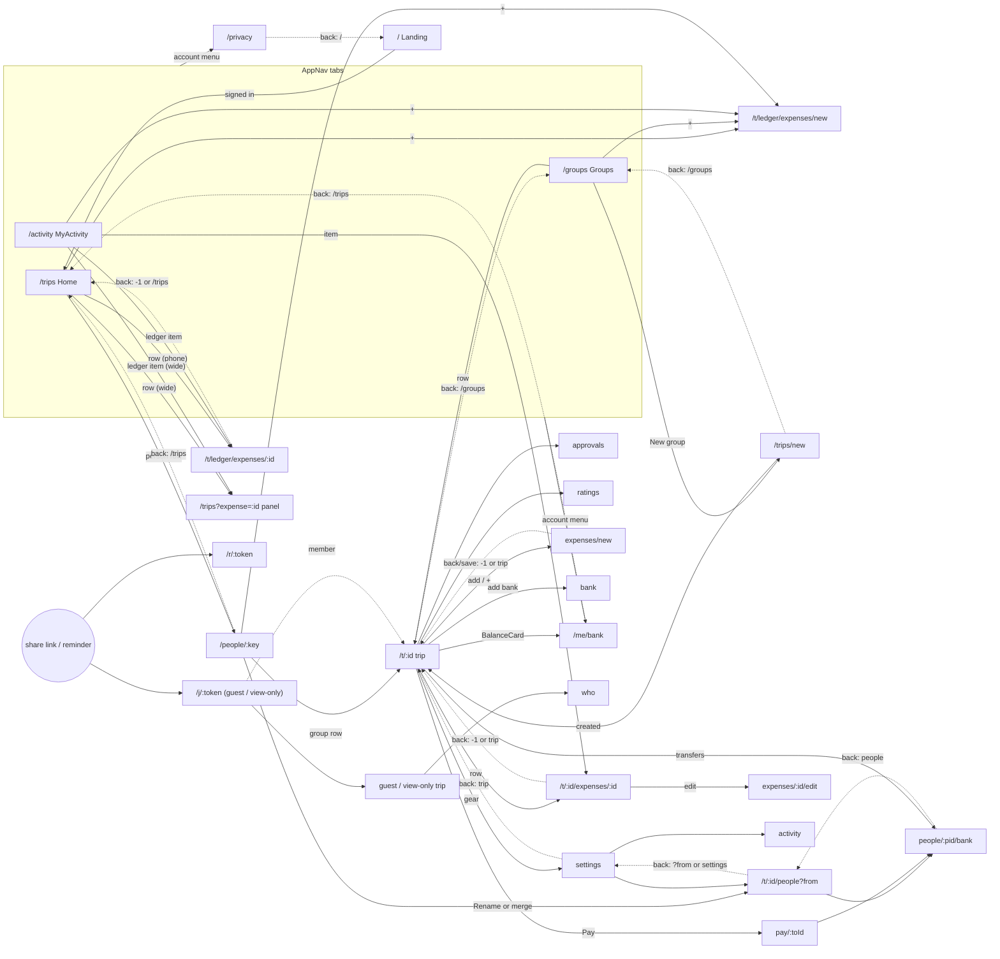

# CoinCrew web: navigation map

Audit of every route and navigation path in `apps/web/src` (React Router v7, `App.tsx`). Written 2026-10-31 on
branch `feat/no-group-expenses`, **including the uncommitted working-tree changes** (CreateTrip back `/groups`,
People `?from=`, PersonScreen "Rename or merge" link). All paths below are relative to `apps/web/src/`.

Terms:

- **Phone** = below 1024px, **wide** = from 1024px (`lib/media.ts:25`, `useIsWide`).
- **Member** = trip under `/t/:tripId`; **guest / view-only** = trip under `/j/:token` (`lib/tripBase.tsx`).
- **Ledger** = the hidden trip with `preset === 'direct'` that holds quick expenses. It has no page of its own.
- **Push / replace** = a new history entry / the current entry is overwritten.

---

## 1. Route table

42 route patterns in all: 9 top-level, 16 under `/t/:tripId`, 17 under `/j/:token` (the same 16 plus `e/:expenseId`).
There is **no catch-all `*` route**: an unknown path renders only `<AuthNotice />` (a blank page).
`screens/Placeholder.tsx` is imported in `App.tsx:2` but not routed.

### Top level

| Route | Component | Shows | Tab (AppNav) |
|---|---|---|---|
| `/` | `Landing` | Sign-in start page; a signed-in user is replaced to `/trips` (`Landing.tsx:27-31`) | no |
| `/trips` | `TripsRoute` -> `Home` (`App.tsx:23-30`) | Home: totals, "by person" list, the ledger's expenses/payments. Wide: ledger details in the right column via `?expense=` / `?payment=` / `?income=` | **home** |
| `/trips?mergeReview=…` or `?tab=groups` | `TripsRoute` -> `<Navigate to="/groups" + search replace>` (`App.tsx:26-27`) | redirect | - |
| `/groups` | `Groups` -> `MyTrips embedded` | Group list, "New group", merge-request banner (`?mergeReview=` is consumed and dropped, `MyTrips.tsx:44-52`) | **groups** |
| `/activity` | `MyActivity` | The user's activity across groups and the ledger | **activity** |
| `/trips/new` | `CreateTrip` | Create-group form | no |
| `/people/:key` | `PersonScreen` | One person across groups: total, per-group rows, merge, settle, request | no (nav shown, section `home`) |
| `/r/:token` | `RequestPage` | Public payment-request page (sent to the debtor) | no |
| `/privacy` | `Privacy` | Privacy policy | no |
| `/me/bank` | `BankDetails` (no trip) | The user's own bank details | no |
| `/t/:tripId/*` | (no element; `tripPages`) | Member trip pages, see below | - |
| `/j/:token/*` | `Join` (resolves token, `TripBaseProvider`, `<Outlet/>`) | Guest / view-only trip pages, see below | - |
| `/j/:token/e/:expenseId` | `OldExpenseLink` -> `<Navigate to="/j/:token/expenses/:id" replace>` (`Join.tsx:66-69`) | redirect (reminder and shared-bill links, `lib/remind.ts:93-97`) | - |

AppNav (`components/AppNav.tsx:23-27`): `home` `/trips`, `groups` `/groups`, `activity` `/activity`, plus a "+" whose
`addHref` each screen passes. Screens that render it: Home (`home`), Groups (`groups`), MyActivity (`activity`),
PersonScreen (`home`), MemberTrip (`groups`, signed in), ViewOnlyTrip (`groups`, signed in), TripRoute FORBIDDEN error
(`groups`). On phones it is a floating footer; from 1024px a left side panel that also holds the account menu.

### Trip pages (`tripPages`, mounted at both `/t/:tripId` and `/j/:token`)

| Child path | Component | Shows (phone / wide) |
|---|---|---|
| (index) | `TripRoute` | `MemberTrip` / `GuestTrip` / `ViewOnlyTrip` by `view.me.kind` |
| `expenses/:expenseId` | `TripRoute` | Phone: `DetailsPage` (own page). Wide: trip page + `DetailsPanel` right column |
| `payments/:paymentId` | `TripRoute` | same |
| `fund/:incomeId` | `TripRoute` | same (fund income) |
| `approvals` | `TripRoute` | Phone: `Approvals` page. Wide: trip page + panel. Non-members redirected to trip |
| `ratings` | `TripRoute` | Phone: `RatingsScreen` page. Wide: trip page + `RatingsPanel`. Redirected to trip unless sport preset with ratings on |
| `who` | `WhoAreYou` | Guest name picker / join |
| `expenses/new` | `ExpenseForm` | Add expense (`?type=income` = add fund income via `IncomeForm`) |
| `expenses/:expenseId/edit` | `ExpenseForm` | Edit expense |
| `fund/:incomeId/edit` | `ExpenseForm` -> `IncomeForm` | Edit fund income |
| `pay/:toId` | `PayScreen` | Pay one person (QR, bank apps) |
| `bank` | `BankDetails` (trip) | Own bank details for this trip |
| `people` | `People` | Manage the group's people (rename, merge, remove, admin, bank) |
| `people/:pid/bank` | `GuestBank` | Bank details a member keeps for a non-member |
| `activity` | `Activity` | The group's activity log |
| `settings` | `Settings` | Group settings (people, activity, archive, leave) |

Redirects inside `TripRoute` (`screens/TripRoute.tsx`), all `replace`:

| Line | Condition | Goes to |
|---|---|---|
| 116-120 | guest without a picked name | `<base>/who?next=<current path+search>` |
| 162-164 | member on `/j/…` | `/t/<tripId><rest>` |
| 165-168 | non-member on `/t/…` with a saved link token | `/j/<token><rest>` |
| 170-172 | ledger, no selection | `/trips` |
| 175-177 | ledger, organiser, wide, a transaction selected | `/trips?<kind>=<id>` (`homeDetailsHref`) |
| 180-182 | `approvals` for a non-member | trip page |
| 185-187 | `ratings` when not enabled | trip page |

Other redirects: `Home.tsx:69-73`, `MyTrips.tsx:60-64`, `MyActivity.tsx:32`, `CreateTrip.tsx:31-35` replace a
signed-out visitor to `/`; `Home.tsx:76-79` replaces `/trips?<kind>=<id>` on a phone with
`/t/<ledger>/<segment>/<id>` (`ledgerDetailsPath`); `GuestBank.tsx:71-73` replaces to the trip when the person is not
a non-member or the caller is not a member; `WhoAreYou.tsx:231-233` replaces a signed-in member to `target`;
`AuthNotice.tsx:26` strips `?auth/linked/merge/provider` with replace.

---

## 2. Entry points per route

(`L` = `<Link to>`, `B` = `<Button href>` (in-app `Link`), `N` = `navigate()`, `R` = `<Navigate>`, `X` = full page
load / external.)

| Route | Entry points |
|---|---|
| `/` | X: typed / first visit. N: sign-out `AccountMenu.tsx:112`; leave group `Settings.tsx:78` (push); signed-out guards (replace) Home:71, MyTrips:62, MyActivity:32, CreateTrip:33. L: Privacy back `Privacy.tsx:11`. B: `Placeholder.tsx:12` (unrouted) |
| `/trips` | L: AppNav home `AppNav.tsx:24` (footer :47, side :99). N: Landing signed-in `Landing.tsx:29` (replace). X: OAuth return `Landing.tsx:59` (`returnTo="/trips"`). R: ledger trip `TripRoute.tsx:171`. Fallbacks: `useBackToTrip(…, '/trips')` `TripRoute.tsx:47`, `useLeaveForm(…, '/trips')` `ExpenseForm.tsx:1548`. L back: PersonScreen `PersonScreen.tsx:96,104,112,262`; `/me/bank` `BankDetails.tsx:63`. Default `addHref` when no ledger: Groups:16, MyActivity:35, PersonScreen:52, ViewOnlyTrip:31, MemberTrip:46, TripRoute:136 |
| `/trips?<kind>=<id>` | L: MyActivity, ledger items on wide `MyActivity.tsx:66-70,98-99`. R: `TripRoute.tsx:176`. Home's own `setSearchParams` (replace) `Home.tsx:53-56` |
| `/groups` | L: AppNav groups `AppNav.tsx:25`. L back: MemberTrip `MemberTrip.tsx:131`, CreateTrip `CreateTrip.tsx:113`. R: TripsRoute `App.tsx:27`. X: OAuth return `MergeSheet.tsx:248` (`/groups?mergeReview=<id>`) |
| `/activity` | L: AppNav activity `AppNav.tsx:26` only |
| `/trips/new` | B: MyTrips "New group" `MyTrips.tsx:79` and empty state `MyTrips.tsx:98` |
| `/people/:key` | L: Home person row `Home.tsx:113-115`. L back: People when `?from=` is a person path `People.tsx:32`. N: after merge `PersonScreen.tsx:164` (replace) |
| `/r/:token` | X only: URL from `requestLink()` shared/copied in `PersonScreen.tsx` (`handleRequestLink`, ~l.222-238) |
| `/privacy` | L: AccountMenu `AccountMenu.tsx:336`; ConsentSheet `ConsentSheet.tsx:40` (on Home, Groups, CreateTrip); Landing `Landing.tsx:86`; BankDetails `BankDetails.tsx:211`; GuestBank `GuestBank.tsx:221` |
| `/me/bank` | L: AccountMenu `AccountMenu.tsx:317`; BalanceCard "add bank" prompt on a member trip `BalanceCard.tsx:106-107` |
| `<base>` (trip page) | L: MyTrips row `MyTrips.tsx:121-123`; PersonScreen group row `PersonScreen.tsx:383-385`. N: after create `CreateTrip.tsx:59` (push); after archive/unarchive `Settings.tsx:62` (push); WhoAreYou `target` default `WhoAreYou.tsx:137,154` (push). L back: Settings `Settings.tsx:34,44,86`; PayScreen `PayScreen.tsx:164,178,393`; BankDetails (trip) `BankDetails.tsx:63`. B: PayScreen "Back to trip" `PayScreen.tsx:223`, "Back" `PayScreen.tsx:280`. Fallbacks (replace): `useBackToTrip` / `useLeaveForm` `lib/detailsNav.ts:61,77`. R: TripRoute :181,:186, GuestBank :72. X: invite links `/j/<token>` `InviteSheet.tsx:137-162`, `lib/remind.ts:90` (`groupLink`); OAuth returns `GuestTrip.tsx:148` (`?becomeMember=1`), `NoAccess` `TripRoute.tsx:143` |
| `<base>/expenses/:id` | N: `useOpenDetails` (push, `state.fromList`) `lib/detailsNav.ts:24-35`, called from list rows via `useDetailsSelection` `DetailsPanel.tsx:98-112` (MemberTrip/GuestTrip/ViewOnlyTrip), Home phone `Home.tsx:101-104`, ApprovalsCard `ApprovalsCard.tsx:41`. L: MyActivity (non-ledger, or ledger on phone) `MyActivity.tsx:66-67,98` (no state). N: sport expense created `ExpenseForm.tsx:665` (replace, no state); rollback `ExpenseHistoryList.tsx:57` (replace, no state). R: Home phone redirect `Home.tsx:78` (replace, no state); OldExpenseLink `Join.tsx:68`. X: shared expense link `lib/remind.ts:93-97` |
| `<base>/payments/:id` | N: `useOpenDetails` from rows; ApprovalsCard `ApprovalsCard.tsx:197`. L: MyActivity `MyActivity.tsx:68-69`. R: Home phone `Home.tsx:78` |
| `<base>/fund/:id` | N: `useOpenDetails` from income rows (`onOpenIncome`) |
| `<base>/approvals` | L: ApprovalQueue "See all" `ApprovalQueue.tsx:29,107` (`useApprovalsLink`, push + `fromList`, replace when switching on wide) |
| `<base>/ratings` | L: LeaderboardWidget `LeaderboardWidget.tsx:143,190,241,262,277` (`useRatingsLink`). X: Google sign-in return `RatingsScreen.tsx:460` |
| `<base>/who` | L: GuestTrip "Switch" `GuestTrip.tsx:98-99`. N: TripRoute guest guard `TripRoute.tsx:118` (replace, `?next=`) |
| `<base>/expenses/new` | L: MemberTrip add `MemberTrip.tsx:57-64`; GuestTrip add `GuestTrip.tsx:74-75`. L: AppNav "+" `AppNav.tsx:66-67,85-88` with `addHref` = this trip (MemberTrip:46) or the ledger (Home:232, Groups:16, MyActivity:35, PersonScreen:52, ViewOnlyTrip:31, MemberTrip archived:46, TripRoute:136). B: FundPill `?type=income` `FundPill.tsx:110` |
| `<base>/expenses/:id/edit` | N: `expenseActions` edit `lib/rowActions.ts:64` (list row swipe `ExpenseList.tsx:46`, details `ExpenseDetails.tsx:191`) |
| `<base>/fund/:id/edit` | N: `incomeActions` edit `lib/rowActions.ts:85` (`ExpenseList.tsx:84`); IncomeDetails `IncomeDetails.tsx:164` |
| `<base>/pay/:toId` | B: BalanceCard "Pay" `BalanceCard.tsx:68` |
| `<base>/bank` | B: YourTransfers "Add bank" `YourTransfers.tsx:64`; L: MyBankRow (guest trip) `MyBankRow.tsx:76-77` |
| `<base>/people` | L: Settings `Settings.tsx:97-98`. B: PersonScreen "Rename or merge in …" `PersonScreen.tsx:481` (`?from=/people/<key>`). L back: GuestBank `GuestBank.tsx:43` |
| `<base>/people/:pid/bank` | N: People row action `People.tsx:115`. B: YourTransfers `YourTransfers.tsx:107`; PayScreen `PayScreen.tsx:302` |
| `<base>/activity` | L: Settings `Settings.tsx:108-109` |
| `<base>/settings` | L: MemberTrip gear `MemberTrip.tsx:115-117`. L back: People (default) `People.tsx:32`; Activity `Activity.tsx:28` |

---

## 3. Exits per route

Kinds: **hard** = hard-coded `back="…"` / `Link`; **hist** = `navigate(-1)` (with a fallback); **param** = depends on a
search param or router state; **none** = no back control.

| Route | Back / close / cancel | Kind | After action |
|---|---|---|---|
| `/` | none | none | sign-in -> OAuth -> `/trips` |
| `/trips` (Home) | none (tab). Wide panel × / Esc: clear `?expense/payment/income` (replace) `Home.tsx:58-67`, `DetailsPanel.tsx:42-48,67` | param | phone row tap -> `/t/<ledger>/<seg>/<id>` push+`fromList` |
| `/groups` | none (tab) | none | - |
| `/activity` | none (tab) | none | - |
| `/trips/new` | `back="/groups"` `CreateTrip.tsx:113` | hard | create -> `navigate('/t/<id>')` push `CreateTrip.tsx:59` |
| `/people/:key` | `back="/trips"` `PersonScreen.tsx:96,104,112,262` | hard | merge -> replace to merged key `:164` |
| `/r/:token` | none | none | - |
| `/privacy` | `back="/"` `Privacy.tsx:11`; `/` replaces a signed-in user to `/trips` | hard | - |
| `/me/bank` | `back="/trips"` (no trip, `BankDetails.tsx:63,109,125,139,152`); success "Back" Link same `:182-183` | hard | save -> success state in place |
| trip index, member | `back="/groups"` `MemberTrip.tsx:131` | hard | - |
| trip index, guest | none (`GuestTrip.tsx:157`) | none | - |
| trip index, view-only | none (`ViewOnlyTrip.tsx:84`); AppNav when signed in | none | - |
| details, phone | `DetailsPage` `onBack` + "Back to trip" (not-found state) = `useBackToTrip(tripId, ledger ? '/trips' : undefined)` `TripRoute.tsx:47-58` | hist | `fromList` -> `-1`; else replace to trip (ledger: `/trips`) |
| details, wide | panel × / Esc = `useBackToTrip(tripId)` `DetailsPanel.tsx:23-25`; row switching replaces the entry and keeps its state `DetailsPanel.tsx:107-109`. The trip header back arrow (`/groups`) is still shown | hist | same; ledger wide never reaches here (redirected to Home) |
| approvals, phone | `onBack = useBackToTrip` `Approvals.tsx:64-66`; leaves by itself when the list empties `Approvals.tsx:20-26` | hist | - |
| approvals, wide | panel × (as details) | hist | auto-close when empty |
| ratings, phone | `onBack = useBackToTrip` `RatingsScreen.tsx:545-547` | hist | - |
| ratings, wide | panel × (as details) | hist | - |
| `who` | none (`WhoAreYou.tsx:210,219,242`) | none | pick / join -> `navigate(target)` push `:137,:154`; `target` = safe `?next=` or trip (`:52`) |
| `expenses/new`, `…/edit`, `fund/…/edit` | `onBack = useLeaveForm(tripId, ledger ? '/trips' : undefined)` `ExpenseForm.tsx:1548`, used at :706, :1561-1675; `IncomeForm.tsx:95` | hist | save -> `leave()` (`ExpenseForm.tsx:632,661,684`, `IncomeForm.tsx:80`); **new sport expense** -> replace to its details, no state `ExpenseForm.tsx:665` |
| `pay/:toId` | `back={href()}` `PayScreen.tsx:164,178,393`; "Back to trip" B `:223`; "Back" B `:280` | hard | - |
| `bank` (trip) | `back={href()}` `BankDetails.tsx:63` | hard | success "Back" Link -> trip |
| `people` | `back` = `?from` if it matches `/people/<x>`, else `href('/settings')` `People.tsx:31-32` | param | - |
| `people/:pid/bank` | `back={href('/people')}` `GuestBank.tsx:43,47,63,140` (hidden after save/delete); success "Back" Links `:231-232,:244-245` | hard | save/delete -> success state in place |
| `activity` (trip) | `back={href('/settings')}` `Activity.tsx:28` | hard | - |
| `settings` | `back={href()}` `Settings.tsx:34,44,86` | hard | archive -> `navigate(href())` push `:62`; leave -> `navigate('/')` push `:78` |

Guest vs member: every trip-relative exit uses `href()` / `base` from `useTrip()`, so a guest stays under
`/j/<token>` and a member under `/t/<id>`. The only member-only hard-coded exit is MemberTrip's `/groups`; guest and
view-only trip pages have no back arrow at all.

Ledger: details and forms fall back to `/trips` instead of the trip; the ledger index is redirected to `/trips`
(`TripRoute.tsx:170-172`); on wide its details open on Home (`TripRoute.tsx:175-177`). Settings/People/Activity of
the ledger exist (reached from PersonScreen "Quick expenses") and their `href()` back links land on `/t/<ledger>`,
which redirects to `/trips`.

---

## 4. Mismatches (back control does not return to where the user came from)

C = confirmed by reading the code paths; S = suspected (depends on runtime, or minor / history-only).

| # | From -> to | Back control does | User expects | Where | |
|---|---|---|---|---|---|
| 1 | `/people/<key>` -> `/t/<id>` (group row) | `/groups` | `/people/<key>` | `PersonScreen.tsx:385` -> `MemberTrip.tsx:131` | C |
| 2 | `/people/<key>` -> `/t/<id>` for a group where the user is a guest / viewer (redirected to `/j/<token>`) | no back arrow (view-only has the nav only) | `/people/<key>` | `TripRoute.tsx:165-168`, `GuestTrip.tsx:157`, `ViewOnlyTrip.tsx:84` | S |
| 3 | `/activity` -> group item `/t/<id>/expenses/<e>` (phone) | details back: no `fromList` -> replace to `/t/<id>`; then trip back -> `/groups` | `/activity` | `MyActivity.tsx:67,98` -> `TripRoute.tsx:47`, `detailsNav.ts:61` | C |
| 4 | `/activity` -> group item (wide) | panel × replaces to `/t/<id>`; header back -> `/groups` | `/activity` | `MyActivity.tsx:67` -> `DetailsPanel.tsx:23`, `MemberTrip.tsx:131` | C |
| 5 | `/activity` -> ledger item (phone) `/t/<ledger>/expenses/<e>` | replace to `/trips` (fallback) | `/activity` | `MyActivity.tsx:67` -> `TripRoute.tsx:47` | C |
| 6 | `/activity` -> ledger item (wide) `/trips?expense=<e>` | × clears the param and stays on Home; Home has no back arrow | `/activity` | `MyActivity.tsx:66` -> `Home.tsx:58-67` | C |
| 7 | trip page -> BalanceCard "add bank" -> `/me/bank` | `/trips` | the trip | `BalanceCard.tsx:107` -> `BankDetails.tsx:63` | C |
| 8 | Groups / Activity / trip / PersonScreen -> AccountMenu -> `/me/bank` | `/trips` | the page the menu was opened on | `AccountMenu.tsx:317` -> `BankDetails.tsx:63` | C (only correct from Home) |
| 9 | any page -> `/privacy` (AccountMenu, ConsentSheet, BankDetails, GuestBank) | `/` -> signed-in users replaced to `/trips`; guests land on Landing and lose the trip | the opener | `Privacy.tsx:11`; links `AccountMenu.tsx:336`, `ConsentSheet.tsx:40`, `BankDetails.tsx:211`, `GuestBank.tsx:221` | C (correct only from Landing, or Home for members) |
| 10 | trip page -> YourTransfers "Add bank for X" -> `people/:pid/bank` | `<base>/people` | the trip | `YourTransfers.tsx:107` -> `GuestBank.tsx:43` | C |
| 11 | PayScreen -> "Add bank for X" -> `people/:pid/bank` | `<base>/people` | `pay/:toId` | `PayScreen.tsx:302` -> `GuestBank.tsx:43` | C |
| 12 | `/people/<key>` -> People (`?from`) -> GuestBank -> back | GuestBank -> `<base>/people` without `?from`; People then backs to `/settings` | People, then `/people/<key>` | `GuestBank.tsx:43`, `People.tsx:32` | C |
| 13 | `/people/<key>` -> People (`?from`) -> back | `/people/<key>` (push) | `/people/<key>` | `People.tsx:32` | OK in the working tree (fixed); still pushes a new entry |
| 14 | MyTrips / CreateTrip -> trip -> back | `/groups` | `/groups` | `MemberTrip.tsx:131` | OK, but it pushes (history becomes `/groups, /t/x, /groups`) |
| 15 | new sport expense saved -> its details (phone) -> back | details have no `fromList`: replace to trip; the trip entry under the form stays, so history is `trip, trip` | trip | `ExpenseForm.tsx:665` | S (history duplicate) |
| 16 | details -> rollback history -> back | rollback replaces the details entry without state: back now replaces to the trip instead of `-1` (ledger: `/trips`) | the list it came from | `ExpenseHistoryList.tsx:57` | S (lands right visually; duplicate entry; from Home phone the ledger fallback is right) |
| 17 | Settings -> archive / unarchive | push to the trip; browser back returns to Settings | trip, Settings gone | `Settings.tsx:62` | S (history only) |
| 18 | guest trip "Switch" -> `who` -> pick | push to trip; browser back returns to `who` | trip | `GuestTrip.tsx:99`, `WhoAreYou.tsx:137` | S (history only) |
| 19 | trip page -> details on wide with the panel open | header back arrow (`/groups`) is still active next to the panel × | close the panel first | `MemberTrip.tsx:131`, `DetailsPanel.tsx:67` | S (design question) |
| 20 | FORBIDDEN trip page (signed in) | no back arrow, nav only | the opener | `TripRoute.tsx:141` | S |

Correct today (checked): list -> details/approvals/ratings -> back (`fromList`, `-1`); any in-app entry -> expense /
income form -> back or save (`useLeaveForm`, `-1`), including the "+" from Home, Groups, Activity and PersonScreen
(the ledger form returns to the opener); Home phone row -> ledger details -> back (`-1` to `/trips`); Settings ->
People / Activity -> back; trip -> Settings / Pay / Bank -> back; People -> GuestBank -> back; shared / typed links to
details or forms (replace to the trip, or `/trips` for the ledger).

---

## 5. Navigation graph

Dotted arrows are the back controls; solid arrows are forward links.

---

## 6. Back-navigation patterns in use today

1. **Hard-coded `back` path on `<Screen>`** (renders a `<Link>`, push). Absolute: MemberTrip `/groups`, CreateTrip
   `/groups`, PersonScreen `/trips`, Privacy `/`, `/me/bank` `/trips`. Trip-relative via `href()`: Settings, PayScreen,
   BankDetails (trip), GuestBank (`/people`), Activity (`/settings`). Also in-page "Back" / "Back to trip" buttons on
   PayScreen, BankDetails, GuestBank.
2. **History with router-state marker, `useBackToTrip`** (`lib/detailsNav.ts:55-63`): `-1` when the entry carries
   `state.fromList` (set by `useOpenDetails`, `useApprovalsLink`, `useRatingsLink`), else replace to the trip or a
   fallback (`/trips` for the ledger). Used by phone details, Approvals, Ratings, the wide DetailsPanel × / Esc and
   the details' "Back to trip" button.
3. **History by entry key, `useLeaveForm`** (`lib/detailsNav.ts:71-79`): `-1` unless `location.key === 'default'`
   (first page of the visit), else replace to the trip / `/trips`. Used by ExpenseForm and IncomeForm for back and
   after save.
4. **Search param `?from=`**: People only (`People.tsx:31-32`), set by PersonScreen (`PersonScreen.tsx:481`),
   validated against `/people/<x>`.
5. **Search params as UI state on Home** (wide): `?expense|payment|income=`; close = delete the param with replace.
   On phones Home turns the same params into a redirect to the ledger's details page.
6. **Safe `?next=` return target**: WhoAreYou (`safeTripPath`, `WhoAreYou.tsx:29-40,52`), set by TripRoute's guest
   guard. Sign-in uses `returnTo` handed to `/api/auth/<provider>/start` (`SignInButtons.tsx:19-26`): Landing,
   NoAccess, GuestTrip, WhoAreYou, RatingsScreen, LinkedAccounts (current path), MergeSheet.
7. **Replace-redirects** that keep the user's address canonical (TripRoute `/t` <-> `/j`, ledger -> Home, TripsRoute
   -> `/groups`, OldExpenseLink, signed-out guards).
8. **No back control**: tabs (Home, Groups, Activity), GuestTrip, ViewOnlyTrip, WhoAreYou, RequestPage, Landing.

## Observations

- Only patterns 2 and 3 know where the user came from; every hard-coded back (pattern 1) assumes one parent, which
  breaks for screens with several entry points (MemberTrip, `/me/bank`, `/privacy`, GuestBank).
- Hard-coded backs push, so the browser/OS back gesture and the on-screen arrow diverge and history grows
  (e.g. `/groups -> /t/x -> /groups`).
- Links that open details from outside a list (MyActivity, sport-create, rollback, Home's phone redirect) carry no
  `fromList`, so they fall back to "replace with trip" even when an app page is behind them.
- `?from=` is a one-hop fix: it is not forwarded to pages opened from People (GuestBank), so the chain breaks one
  level down.
