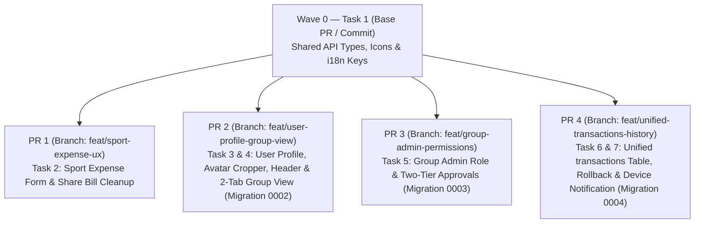

# User Profile, Group Admin Permissions, Sport Expense UX & Unified Transactions Implementation Plan

> **For agentic workers:** REQUIRED SUB-SKILL: Use superpowers:subagent-driven-development (recommended) or superpowers:executing-plans to implement this plan task-by-task. Steps use checkbox (`- [ ]`) syntax for tracking.

**Goal:** Deliver five cohesive upgrades across CoinCrew (Tiền Đâu)—User Profile & Gmail-style Avatar Cropper with consolidated headers/settings, Group Admin role & two-tier guest approval permissions, Sport Add Expense UX & Share Bill cleanup, Group View 2-tab (`Expenses` | `Payments`) switcher, and a unified append-only `transactions` ledger with versionless edit history, icon-only rollback (`↺`), and one-time per-device update notifications—structured into **parallel PR tracks**.

**Architecture:** A lightweight foundation task (**Task 1 / Wave 0**) lands shared TypeScript interfaces (`@fsl/core`), SVG icons, and i18n keys (`en.ts`, `vi.ts`) first so that **4 independent PR tracks** (**PR 1: Sport Expense UX**, **PR 2: User Profile, Avatar & Group View Tabs**, **PR 3: Group Admin Permissions**, **PR 4: Unified Transactions Ledger, History & Update Notification**) can be developed in parallel across isolated git worktrees and delivered as separate PRs with minimal merge overlap. Distinct D1 migration numbers (`0002`, `0003`, `0004`) ensure database migrations compose cleanly in any merge order.

**Tech Stack:** TypeScript, Hono + Drizzle ORM on Cloudflare Workers D1, React 19 + React Router 7 + TanStack Query, Vite, Vitest + Testing Library, HTML5 `<canvas>`.

**Spec:** `docs/superpowers/specs/2026-10-17-ui-ux-and-transactions-design.md` (and Obsidian `[[2026-10-17-ui-ux-and-transactions-design]]`).

## Parallel PR Execution Map



## Global Constraints

- **Zero new npm dependencies.**
- **Cloudflare Workers + D1 limits:** Never pass unbounded ID arrays to `inArray(...)`; always use subqueries (`db.select({ id: ... })`) to stay under D1's 100 bound parameters per query limit.
- **Whole-VND integer math (`@fsl/core`):** All currency amounts are safe integers in VND (`parseVnd`, `formatVnd`).
- **Design tokens & accessibility (`tokens.css`):** Use CSS custom properties from `apps/web/src/styles/tokens.css`, Lucide SVG icons in `apps/web/src/components/icons.tsx`, complete interactive states, WCAG 2.2 AA contrast, and zero horizontal overflow at `375px`, `768px`, and `1280px`.
- **i18n parity:** Every new or modified key in `apps/web/src/i18n/en.ts` must have a matching entry in `apps/web/src/i18n/vi.ts` ending with `// REVIEW`.
- **History UI rule:** Never show version numbers (`v1`, `v2`, `v3`) in the Expense History UI—only show the updated content summary and an icon-only rollback button (`<Icon name="rotateCcw" />`).

## Review Focus

1. **Subsequent Google sign-in after user customized their name or avatar (`custom_profile = 1`):** `/api/auth/google/callback` must preserve the user's custom `name` and `avatar_url` when `custom_profile === 1`, while still populating `avatar_url` from Google's `picture` claim on first login or when `avatar_url` is `null`.
2. **Non-admin signed-in member attempting to approve a guest expense they are not involved in:** `POST /api/trips/:id/expenses/:eid/approve` must return `403 FORBIDDEN` when `actor.isAdmin === false` and `actor.participantId` is neither `expense.payerId` nor in `expense.shares`, while succeeding (`204`) when `actor.participantId` is in `expense.shares` or is `expense.payerId`.
3. **Editing an expense then rolling back to a prior entry via its original `expenseId`:** Because `PATCH /expenses/:eid` and `POST /expenses/:eid/rollback` create a new head row (`is_latest = 1`) and mark the old row `status = 'superseded', is_latest = 0`, looking up by either the latest `id` or `root_id` must resolve the current head row and preserve all prior rows in `expense.history` (including the rolled-back-from row).
4. **Player bringing guests in Sport mode (`1M` base + `1♀` + `1♂` guests = `2M, 1F` total slots):** Toggling or incrementing guest counters in `ExpenseForm.tsx` must add the guest slots on top of the player's own base gender slot (`maleSlots = baseMale + guestMale`, `femaleSlots = baseFemale + guestFemale`) so the player's row share covers both themselves and their guests.
5. **One-time per-device update notification (`UpdatedTransactionsBanner`):** An expense edited by another participant must show the update banner once on a guest/member device, and once dismissed or viewed (`fsl_seen_tx_updates_${tripId}`), must not reappear on that device unless edited again (producing a new head `id`).

---

## Wave 0: Shared Foundation (Run First)

### Task 1: Shared Core Types, SVG Icons & i18n Keys (`@fsl/core` & `@fsl/web`)

**Files:**
- Modify: `packages/core/src/api-types.ts:14-150`
- Modify: `packages/core/src/permissions.ts:3-15`
- Modify: `apps/web/src/components/icons.tsx:1-90`
- Modify: `apps/web/src/i18n/en.ts`
- Modify: `apps/web/src/i18n/vi.ts`
- Test: `apps/web/test/scaffold.test.tsx`

**Interfaces:**
- Consumes: `Gender`, `SplitMode`, `ExpenseMeta` from `packages/core/src/split.ts` and `api-types.ts`
- Produces:
  - `packages/core/src/api-types.ts`:
    ```ts
    export interface MeUserView {
      id: string;
      email: string;
      name: string;
      gender?: Gender | null;
      avatarUrl?: string | null;
      consentAt: string | null;
    }
    export interface UpdateProfileInput {
      name?: string;
      gender?: Gender | null;
      avatarUrl?: string | null;
    }
    export interface ExpenseHistoryItem {
      id: string;
      description: string;
      amount: number;
      spentOn: string;
      payerId: string;
      mode: SplitMode;
      createdById: string;
      createdAt: string;
      shares: { participantId: string; amount: number; inputValue: number }[];
      meta?: ExpenseMeta | null;
    }
    ```
    - `ActivityAction` adds `'admin_promoted'` and `'expense_rolled_back'`.
    - `CreateTripInput` adds `defaultLang?: 'en' | 'vi'`.
    - `PersonView` adds `isAdmin?: boolean; avatarUrl?: string | null`.
    - `ExpenseView` adds `rootId?: string; history?: ExpenseHistoryItem[]`.
    - `TripView['trip']` adds `defaultLang?: 'en' | 'vi'`.
    - `TripView['me']` adds `isAdmin?: boolean`.
  - `packages/core/src/permissions.ts`:
    - `Actor` adds `isAdmin?: boolean`.
    - `ActionContext` adds `expenseInvolved?: boolean`.
  - `apps/web/src/components/icons.tsx`:
    - `IconName` adds `'rotateCcw' | 'camera' | 'shield'`.

- [ ] **Step 1: Write failing test in `apps/web/test/scaffold.test.tsx` checking new icons and i18n keys**

Add assertions in `apps/web/test/scaffold.test.tsx` that `en` and `vi` define the new keys (`sport.shuttlecocks` = `'Shuttlecocks'`, `sport.addShuttlecock`, `sport.addExtraFee`, `sport.bringsGuest`, `sport.femaleGuest`, `sport.maleGuest`, `sport.orFixedAmount`, `settings.title` = `'Group settings'`, `settings.archive` = `'Archive group'`, `account.changePhoto`, `account.cropTitle`, `account.gender`, `people.admin`, `people.makeAdmin`, `expense.historyTitle`, `expense.rollback`, `updates.bannerTitle`, `updates.viewAll`).

- [ ] **Step 2: Run test to verify it fails**

Run: `npm test -w @fsl/web -- test/scaffold.test.tsx`
Expected: FAIL with missing keys/icons.

- [ ] **Step 3: Update `packages/core/src/api-types.ts`, `packages/core/src/permissions.ts`, `apps/web/src/components/icons.tsx`, `apps/web/src/i18n/en.ts`, and `apps/web/src/i18n/vi.ts`**

Add the additive types in `api-types.ts` and `permissions.ts`, add SVG paths for `'rotateCcw'`, `'camera'`, and `'shield'` in `icons.tsx`, and add/update the i18n keys in `en.ts` and `vi.ts` (each `vi.ts` line ending with `// REVIEW`):
- Update `sport.shuttlecocks`: `'Shuttlecocks'` / `'Tiền cầu'` (`// REVIEW`)
- Update `settings.title`: `'Group settings'` / `'Cài đặt nhóm'` (`// REVIEW`)
- Update `settings.archive`: `'Archive group'` / `'Lưu trữ nhóm'` (`// REVIEW`)
- Add `sport.addShuttlecock`, `sport.addExtraFee`, `sport.bringsGuest`, `sport.femaleGuest`, `sport.maleGuest`, `sport.orFixedAmount`, `account.changePhoto`, `account.cropTitle`, `account.zoom`, `account.saveProfile`, `account.gender`, `people.admin`, `people.makeAdmin`, `expense.historyTitle`, `expense.rollback`, `updates.bannerTitle`, `updates.viewAll`, `updates.previous`, `updates.now`, `updates.dismiss`.

- [ ] **Step 4: Run tests across all workspaces to verify green baseline**

Run: `npm test`
Expected: PASS across `@fsl/core`, `@fsl/api`, and `@fsl/web`.

- [ ] **Step 5: Commit Wave 0 foundation**

```bash
git add packages/core/src/api-types.ts packages/core/src/permissions.ts apps/web/src/components/icons.tsx apps/web/src/i18n/en.ts apps/web/src/i18n/vi.ts apps/web/test/scaffold.test.tsx
git commit -m "feat(core,web): add shared API types, icons, and i18n keys for parallel PRs"
```

---

## PR Track 1: Sport Add Expense View & Share Bill Cleanup (`feat/sport-expense-ux`)

> **Parallelism:** Depends only on Task 1. Touches only `ExpenseForm.tsx`, `ExpenseForm.css`, `ExpenseDetails.tsx`, `components.css`, and `sport-expense.test.tsx`. Can be executed in parallel with PR Tracks 2, 3, and 4.

### Task 2: Dynamic Sport Cost Buttons, Compact Checkbox, Guest/Fixed Drawer, Admin Gender Quick-Edit & Share Bill Cleanup (`@fsl/web`)

**Files:**
- Modify: `apps/web/src/screens/ExpenseForm.tsx:102-950`
- Modify: `apps/web/src/screens/ExpenseForm.css`
- Modify: `apps/web/src/styles/components.css`
- Modify: `apps/web/src/components/ExpenseDetails.tsx:340-377`
- Test: `apps/web/test/sport-expense.test.tsx`

**Interfaces:**
- Consumes: `computeSportShares`, `SportParticipantEntry`, `ExpenseSportMeta` from `@fsl/core`; i18n keys from Task 1.
- Produces:
  - Updated `ExpenseForm.tsx`:
    - Initially hides Shuttlecocks and Extra fee inputs unless editing an expense with `shuttlecocks.length > 0` or `extra > 0`.
    - Renders `+ Add shuttlecock price` (`t('sport.addShuttlecock')`) and `+ Add extra fee` (`t('sport.addExtraFee')`) action pills below the Court field; each shuttlecock row and the extra fee field has an `×` remove button.
    - Tracks per-player `guestFemaleSlots` (`0..20`) and `guestMaleSlots` (`0..20`) in the inline Edit drawer under `"This player brings guest?"` (`t('sport.bringsGuest')`), plus fixed override under `"Or want to set a fixed amount for {name}"` (`t('sport.orFixedAmount', { name })`). Total player slots submitted in `SportParticipantEntry` are `maleSlots = baseMale + guestMaleSlots` and `femaleSlots = baseFemale + guestFemaleSlots`.
    - When `view.me.isAdmin || view.me.isOrganiser` is true, clicking/pressing a player's gender/info badge opens a quick-edit popover that calls `PATCH /api/trips/${tripId}/people/${person.id}` with `{ gender: 'M' | 'F' }`.
  - Updated `ExpenseDetails.tsx`:
    - Removes `.fsl-sport-preview-title`, `.fsl-sport-preview-msg`, and `.fsl-sport-preview-qr`, keeping the breakdown table and the primary `Share bill & QR` button directly below the table.

- [ ] **Step 1: Write the failing tests in `apps/web/test/sport-expense.test.tsx`**

```tsx
it('initially hides shuttlecock and extra fee inputs until + buttons are clicked, and computes guest slots + fixed override in the two-part drawer', async () => {
  // 1. Render ExpenseForm for a sport group
  // 2. Expect Court input to be visible, while Shuttlecocks and Extra fee inputs are not in the document
  // 3. Click "+ Add shuttlecock price" -> Shuttlecocks qty and unitPrice inputs appear
  // 4. Open Edit drawer for a male player (Minh) -> see "This player brings guest?" and "Or want to set a fixed amount for Minh"
  // 5. Increment Female guest (+1) and Male guest (+1) -> Minh row shows 3 slots (1F, 2M) and share for 3 slots
});

it('renders Share bill & QR button in ExpenseDetails without the redundant Zalo text/QR preview box', async () => {
  // Render ExpenseDetails with a sport expense
  // Expect Share bill & QR button to be present and class .fsl-sport-preview-msg not to be in the document
});
```

- [ ] **Step 2: Run test to verify it fails**

Run: `npm test -w @fsl/web -- test/sport-expense.test.tsx`
Expected: FAIL because shuttlecock/extra inputs are always visible and `.fsl-sport-preview-msg` is still rendered.

- [ ] **Step 3: Implement updates in `ExpenseForm.tsx`, `ExpenseForm.css`, `components.css`, and `ExpenseDetails.tsx`**

1. In `apps/web/src/styles/components.css`: change `.fsl-split-row__check-label` from `width: 44px; justify-content: center;` to `width: auto; padding-right: var(--space-1); justify-content: flex-start;`.
2. In `apps/web/src/screens/ExpenseForm.tsx`:
   - Initialize `shuttleRows` to `[]` for new expenses (or existing rows when editing) and `showExtra` to `Boolean(expense?.meta?.sport?.extra && expense.meta.sport.extra > 0)`.
   - Render `+ Add shuttlecock price` (when `shuttleRows.length < 3`) and `+ Add extra fee` (when `!showExtra`) buttons below the Court row.
   - Update the player row Edit drawer to show:
     - Section 1: `t('sport.bringsGuest')` with `♀` (`t('sport.femaleGuest')`) and `♂` (`t('sport.maleGuest')`) stepper controls (`−` / count / `+`) that add to the player's base slot (`1 M` or `1 F`).
     - Section 2: `t('sport.orFixedAmount', { name: person.name })` with the VND fixed input below it.
   - Add Admin player gender quick-edit popover on player avatar/gender badge click when `view.me.isAdmin || view.me.isOrganiser`.
3. In `apps/web/src/components/ExpenseDetails.tsx`: remove the `<h3 className="fsl-sport-preview-title">`, `<p className="fsl-sport-preview-msg">`, and `<div className="fsl-sport-preview-qr">` elements, keeping the `<Button onClick={handleShareSportBill}>` action bar directly below `.fsl-sport-table-container`.

- [ ] **Step 4: Run web tests to verify they pass**

Run: `npm test -w @fsl/web`
Expected: PASS.

- [ ] **Step 5: Commit PR Track 1**

```bash
git add apps/web/src/screens/ExpenseForm.tsx apps/web/src/screens/ExpenseForm.css apps/web/src/styles/components.css apps/web/src/components/ExpenseDetails.tsx apps/web/test/sport-expense.test.tsx
git commit -m "feat(web): refine sport expense form, guest slot drawer, and bill share view"
```

---

## PR Track 2: User Profile, Avatar Cropper, Header Layout & Group View 2-Tab Switcher (`feat/user-profile-group-view`)

> **Parallelism:** Depends only on Task 1. Uses migration `0002_user_profile_and_trip_defaults.sql`. Can be executed in parallel with PR Tracks 1, 3, and 4.

### Task 3: User Profile, Avatar & Trip Defaults Backend (`@fsl/api`)

**Files:**
- Create: `apps/api/migrations/0002_user_profile_and_trip_defaults.sql`
- Modify: `apps/api/src/db/schema.ts:3-31`
- Modify: `apps/api/src/auth/routes.ts:57-126`
- Modify: `apps/api/src/trips/routes.ts:62-175`
- Modify: `apps/api/src/trips/snapshot.ts:122-265`
- Test: `apps/api/test/auth.test.ts`
- Test: `apps/api/test/trips.test.ts`

**Interfaces:**
- Consumes: `MeUserView`, `UpdateProfileInput` from `@fsl/core`
- Produces:
  - Migration `0002_user_profile_and_trip_defaults.sql`:
    ```sql
    ALTER TABLE users ADD COLUMN gender TEXT;
    ALTER TABLE users ADD COLUMN avatar_url TEXT;
    ALTER TABLE users ADD COLUMN custom_profile INTEGER NOT NULL DEFAULT 0;
    ALTER TABLE trips ADD COLUMN default_lang TEXT NOT NULL DEFAULT 'vi';
    ```
  - `GET /api/me` returns `{ user: MeUserView | null }` including `gender` and `avatarUrl`.
  - `PATCH /api/me` accepts `UpdateProfileInput` (`{ name?, gender?, avatarUrl? }`), sets `custom_profile = 1` when `name` or `avatarUrl` is provided, updates `users`, and syncs `name` (`normalized_name`) and `gender` to all active `participants` where `user_id = user.id` (bumping `trips.version`).
  - `GET /api/auth/google/callback` reads `picture?: string` from ID token claims; on insert sets `avatarUrl: claims.picture ?? null`; on existing user, only updates `name` if `existingUser.customProfile === 0` and only updates `avatarUrl` if `existingUser.customProfile === 0 || !existingUser.avatarUrl`.
  - `POST /api/trips` inserts `fewestTransfers: 0` (disabled by default) and `defaultLang: body.defaultLang ?? 'vi'`.

- [ ] **Step 1: Write failing tests in `apps/api/test/auth.test.ts` and `apps/api/test/trips.test.ts`**

Add tests in `apps/api/test/auth.test.ts` and `apps/api/test/trips.test.ts`:
```ts
it('populates google picture on sign-in, allows PATCH /api/me to update name/gender/avatarUrl, and preserves custom profile on next sign-in', async () => {
  // 1. Callback with claims { sub: 'g-1', email: 'a@b.com', name: 'Google Name', picture: 'https://lh3.google.com/a' }
  // 2. GET /api/me -> avatarUrl === 'https://lh3.google.com/a'
  // 3. PATCH /api/me with { name: 'Custom Name', gender: 'M', avatarUrl: 'data:image/webp;base64,AAAA' } -> 200
  // 4. Subsequent callback with Google claims -> GET /api/me still has name: 'Custom Name' and custom avatarUrl
});

it('creates new groups with fewestTransfers: false (0) and defaultLang by default', async () => {
  // POST /api/trips -> GET /api/trips/:id -> view.trip.fewestTransfers === false
});
```

- [ ] **Step 2: Run tests to verify they fail**

Run: `npm test -w @fsl/api -- test/auth.test.ts test/trips.test.ts`
Expected: FAIL (`PATCH /api/me` 404 and `fewestTransfers` is `true`).

- [ ] **Step 3: Implement migration `0002`, `schema.ts`, `auth/routes.ts`, `trips/routes.ts`, and `trips/snapshot.ts`**

1. Create `apps/api/migrations/0002_user_profile_and_trip_defaults.sql`.
2. Add `gender`, `avatarUrl`, `customProfile` to `users` and `defaultLang` (plus `.default(0)` on `fewestTransfers`) to `trips` in `apps/api/src/db/schema.ts`.
3. Update `apps/api/src/auth/routes.ts` (`GET /auth/google/callback`, `GET /me`, and add `PATCH /me`).
4. Update `apps/api/src/trips/routes.ts` (`fewestTransfers: 0`, `defaultLang`) and `apps/api/src/trips/snapshot.ts` (include `defaultLang` on `trip` and member `avatarUrl` on `PersonView`).

- [ ] **Step 4: Run API tests to verify they pass**

Run: `npm test -w @fsl/api`
Expected: PASS (update any existing test in `trips.test.ts` that assumed `fewestTransfers` defaulted to `true` on `POST /trips` unless toggled via `PATCH /trips/:id/settings`).

- [ ] **Step 5: Commit Task 3**

```bash
git add apps/api/migrations/0002_user_profile_and_trip_defaults.sql apps/api/src/db/schema.ts apps/api/src/auth/routes.ts apps/api/src/trips/routes.ts apps/api/src/trips/snapshot.ts apps/api/test/
git commit -m "feat(api): add user profile/avatar endpoints, google avatar sync, and group defaults"
```

### Task 4: Avatar Cropper Modal, AccountMenu Profile Editor, Member Header, 2-Tab Group View & Settings Cleanup (`@fsl/web`)

**Files:**
- Modify: `apps/web/src/components/Avatar.tsx`
- Modify: `apps/web/src/components/Avatar.css`
- Create: `apps/web/src/components/AvatarCropModal.tsx`
- Create: `apps/web/src/components/AvatarCropModal.css`
- Modify: `apps/web/src/components/AccountMenu.tsx`
- Modify: `apps/web/src/components/LanguageButton.tsx`
- Modify: `apps/web/src/components/Screen.tsx`
- Modify: `apps/web/src/components/Screen.css`
- Modify: `apps/web/src/screens/MemberTrip.tsx`
- Modify: `apps/web/src/screens/GuestTrip.tsx`
- Modify: `apps/web/src/screens/ViewOnlyTrip.tsx`
- Modify: `apps/web/src/screens/Settings.tsx`
- Test: `apps/web/test/profile-and-tabs.test.tsx`

**Interfaces:**
- Consumes: `GET /api/me`, `PATCH /api/me` from Task 3
- Produces:
  - `Avatar.tsx` accepts `avatarUrl?: string | null` and renders `` when present.
  - `AvatarCropModal.tsx`: Gmail-style circular cropper with drag-to-pan and zoom range input (`1..3`), exporting a `256×256` data URL via `<canvas>` (falling back to original data URL if canvas 2D context is unavailable in JSDOM).
  - `AccountMenu.tsx`: allows editing `name`, `gender` (`M`/`F`), and avatar (via `AvatarCropModal`) and saving via `PATCH /api/me`. If `user` prop is omitted, reads `useQuery(['me'])`.
  - `Screen.tsx`: accepts `titleAlign?: 'left' | 'center'`.
  - `MemberTrip.tsx`: passes `titleAlign="left"` and renders `<AccountMenu />` in `right={header}` alongside Invite and Settings.
  - `MemberTrip.tsx`, `GuestTrip.tsx`, `ViewOnlyTrip.tsx`: renders a 2-tab segmented switcher (`Expenses` | `Payments`, `role="tablist"`) below Balance & Your Transfers on mobile/narrow view.
  - `LanguageButton.tsx`: renders `<Icon name="language" size={20} />` AND the current language name (`lang === 'vi' ? t('lang.vi') : t('lang.en')`).
  - `Settings.tsx`: removes the Bank and Language rows; keeps People, Activity, FewestSwitch, and organiser-only Archive group.

- [ ] **Step 1: Write failing tests in `apps/web/test/profile-and-tabs.test.tsx`**

```tsx
it('renders visible language text in LanguageButton and omits Bank/Language from Group Settings', async () => {
  // 1. Render LanguageButton -> expect 'Tiếng Việt' or 'English' text to be visible
  // 2. Render Settings -> expect 'People' and 'Activity' links, and no '/bank' link or LanguageButton
});

it('renders left-aligned title and AccountMenu avatar in MemberTrip header, and switches between Expenses and Payments tabs', async () => {
  // 1. Render MemberTrip -> expect AccountMenu trigger button in header and Expenses tab active by default
  // 2. Click Payments tab -> expect PaymentsList to be rendered
});
```

- [ ] **Step 2: Run test to verify it fails**

Run: `npm test -w @fsl/web -- test/profile-and-tabs.test.tsx`
Expected: FAIL.

- [ ] **Step 3: Implement `Avatar`, `AvatarCropModal`, `AccountMenu`, `LanguageButton`, `Screen`, `MemberTrip`, `GuestTrip`, `ViewOnlyTrip`, and `Settings`**

Implement the components and screen updates as specified in Interfaces above. Also update `apps/web/src/i18n/index.tsx` (or `GuestTrip.tsx`) so that if `localStorage.getItem('fsl_lang')` is not set when loading a shared link with `?lang=en|vi` or `view.trip.defaultLang`, the initial language inherits from the query param or `view.trip.defaultLang`.

- [ ] **Step 4: Run web tests to verify they pass**

Run: `npm test -w @fsl/web`
Expected: PASS.

- [ ] **Step 5: Commit Task 4 (completing PR Track 2)**

```bash
git add apps/web/src/ apps/web/test/
git commit -m "feat(web): add avatar cropper, profile settings, member header avatar, and group view tabs"
```

---

## PR Track 3: Group Admin Role & Two-Tier Guest Approval Matrix (`feat/group-admin-permissions`)

> **Parallelism:** Depends only on Task 1. Uses migration `0003_group_admin.sql`. Can be executed in parallel with PR Tracks 1, 2, and 4.

### Task 5: Group Admin Role, Involved-Member Expense Approval, Admin-Only Bank/Identity Approvals & Guest Roster Lock (`@fsl/core`, `@fsl/api`, `@fsl/web`)

**Files:**
- Create: `apps/api/migrations/0003_group_admin.sql`
- Modify: `apps/api/src/db/schema.ts:32-52`
- Modify: `packages/core/src/permissions.ts:15-45`
- Modify: `apps/api/src/access/actor.ts:28-52`
- Modify: `apps/api/src/trips/routes.ts:172-183`
- Modify: `apps/api/src/trips/snapshot.ts:122-141`
- Modify: `apps/api/src/trips/view.ts:20-150`
- Modify: `apps/api/src/participants/routes.ts:195-685`
- Modify: `apps/api/src/expenses/routes.ts:457-570`
- Modify: `apps/api/src/bank/routes.ts:266-464`
- Modify: `apps/web/src/screens/WhoAreYou.tsx`
- Modify: `apps/web/src/screens/People.tsx`
- Test: `packages/core/test/permissions.test.ts`
- Test: `apps/api/test/admin-permissions.test.ts`

**Interfaces:**
- Consumes: `Actor.isAdmin`, `ActionContext.expenseInvolved` from Task 1
- Produces:
  - Migration `0003_group_admin.sql`:
    ```sql
    ALTER TABLE participants ADD COLUMN is_admin INTEGER NOT NULL DEFAULT 0;
    UPDATE participants SET is_admin = 1 WHERE user_id = (SELECT organiser_user_id FROM trips WHERE trips.id = participants.trip_id);
    ```
  - `packages/core/src/permissions.ts`:
    - `Action` adds `'approve_expense' | 'add_person' | 'promote_admin'`.
    - `can(actor, action, ctx)`:
      - `'approve_expense'`: `isMember && (Boolean(actor.isAdmin) || actor.isOrganiser || ctx.expenseInvolved === true)`
      - `'approve'`, `'manage_bank'`, `'merge'`, `'remove_person'`, `'regenerate_links'`, `'set_fewest'`, `'add_person'`, `'promote_admin'`: `isMember && (Boolean(actor.isAdmin) || actor.isOrganiser)`
  - `POST /api/trips/:id/people`: requires `ensure(actor, 'add_person')` (guests and non-admin members receive `403 FORBIDDEN`).
  - `POST /api/trips/:id/people/:pid/admin`: promotes an active member (`userId !== null`) to `isAdmin = 1` (requires `ensure(actor, 'promote_admin')`; returns `422` if target is a guest).
  - `POST /api/trips/:id/expenses/:eid/approve` and `reject`: checks whether `actor.participantId` is `e.payerId` or in `expense_shares` (`expenseInvolved`), and calls `ensure(actor, 'approve_expense', { expenseInvolved })`.
  - `POST /api/trips/:id/membership`: accepts optional `{ participantId, name?, gender? }`; when a Group Admin approves (`POST /api/trips/:id/membership/:rid/approve`), links `userId` and applies the claiming user's `name` and `gender` to the `participants` row.
  - `WhoAreYou.tsx`: removes the `"I'm new here / Add new name"` form for guests; displays only the group's existing participant list and the `"Sign in with Google"` button.
  - `People.tsx`: displays an `Admin` pill on admin participants and a `"Make admin"` action for Group Admins on non-admin signed-in members; hides the `"Add person"` form for non-admins.

- [ ] **Step 1: Write failing unit and API tests in `packages/core/test/permissions.test.ts` and `apps/api/test/admin-permissions.test.ts`**

```ts
it('allows an involved non-admin member to approve a guest expense, but forbids an uninvolved non-admin member', async () => {
  // Seed trip with Minh (organiser/admin), An (non-admin member), Bình (guest), Chi (guest)
  // Guest Bình adds expense paid by Bình split between Bình and Chi (An is NOT involved)
  // An POST /expenses/:id/approve -> 403 FORBIDDEN
  // Guest Bình adds expense paid by Bình split between Bình and An (An IS involved)
  // An POST /expenses/:id/approve -> 204
});

it('forbids guests from adding a new name via POST /trips/:id/people and restricts guest bank/membership approval to Group Admins', async () => {
  // 1. Guest POST /trips/:id/people -> 403
  // 2. Non-admin member An POST /trips/:id/bank/:bid/approve -> 403
  // 3. Organiser Minh promotes An via POST /trips/:id/people/:anId/admin -> 204
  // 4. Now An POST /trips/:id/bank/:bid/approve -> 204
});
```

- [ ] **Step 2: Run tests to verify they fail**

Run: `npm test -w @fsl/core -- test/permissions.test.ts && npm test -w @fsl/api -- test/admin-permissions.test.ts`
Expected: FAIL.

- [ ] **Step 3: Implement migration `0003`, `permissions.ts`, API routes, `WhoAreYou.tsx`, and `People.tsx`**

Implement the schema, permission matrix, route guards, `POST /trips/:id/people/:pid/admin`, `view.ts` approval filtering (non-admin members only receive `kind: 'expense'` approvals where they are payer or share participant, plus `kind: 'payment'` / `'not_arrived'` where `toId === actor.participantId`), `WhoAreYou.tsx` roster-only view, and `People.tsx` admin badge/promotion action.

- [ ] **Step 4: Run core, API, and web tests to verify they pass**

Run: `npm test`
Expected: PASS (update any legacy test in `participants.test.ts` that tested guest `POST /trips/:id/people` to assert `403 FORBIDDEN` for guests and `201` for admins).

- [ ] **Step 5: Commit Task 5 (completing PR Track 3)**

```bash
git add apps/api/migrations/0003_group_admin.sql apps/api/src/ packages/core/ apps/web/src/screens/WhoAreYou.tsx apps/web/src/screens/People.tsx apps/api/test/
git commit -m "feat(core,api,web): add group admin role, involved-member expense approval, and guest roster lock"
```

---

## PR Track 4: Unified `transactions` Ledger, Edit History/Rollback & Update Notification (`feat/unified-transactions-history`)

> **Parallelism:** Depends only on Task 1. Uses migration `0004_unified_transactions.sql`. Can be executed in parallel with PR Tracks 1, 2, and 3.

### Task 6: Unified `transactions` + `transaction_shares` Schema, Snapshot Ledger & Append-Only Edit/Rollback API (`@fsl/api`)

**Files:**
- Create: `apps/api/migrations/0004_unified_transactions.sql`
- Modify: `apps/api/src/db/schema.ts:106-178`
- Modify: `apps/api/src/trips/snapshot.ts:20-268`
- Modify: `apps/api/src/expenses/routes.ts:240-675`
- Modify: `apps/api/src/payments/routes.ts:134-508`
- Modify: `apps/api/src/participants/routes.ts:462-500`
- Modify: `apps/api/src/participants/merge.ts:77-216`
- Modify: `apps/api/test/helpers.ts:79-132`
- Test: `apps/api/test/transactions-history.test.ts`

**Interfaces:**
- Consumes: `ExpenseHistoryItem`, `ExpenseView` from Task 1
- Produces:
  - Migration `0004_unified_transactions.sql`:
    - Creates `transactions` (`id, root_id, parent_id, is_latest, trip_id, type, description, amount, amount_confirmed, currency, spent_on, payer_id, to_id, split_mode, status, reject_reason, not_arrived_at, disabled_by_user_id, created_by_participant_id, created_by_device, confirmed_by_participant_id, meta_json, created_at, updated_at`) and `transaction_shares` (`transaction_id, participant_id, input_value, amount`).
    - Migrates all existing `expenses`, `expense_shares`, and `payments` rows into `transactions` and `transaction_shares`, then drops `expense_shares`, `expenses`, and `payments`.
  - `PATCH /api/trips/:id/expenses/:eid`:
    - Resolves active expense head row where `(id = :eid OR root_id = :eid) AND is_latest = 1 AND type = 'expense'`.
    - Marks the old head row `status = 'superseded', is_latest = 0, updated_at = now`.
    - Inserts a new head row (`id = newId()`, `rootId = old.rootId`, `parentId = old.id`, `isLatest = 1`, `status = old.status`) and its `transaction_shares`.
    - Returns `200` with `{ expenseId: newHeadId, rootId: old.rootId }`.
  - `POST /api/trips/:id/expenses/:eid/rollback`:
    - Body: `{ targetHistoryId: string }`.
    - Resolves current head row (`(id = :eid OR root_id = :eid) AND is_latest = 1`) and target historical row (`id = targetHistoryId AND root_id = head.rootId AND is_latest = 0`).
    - Marks current head row `status = 'superseded', is_latest = 0` and inserts a new head row copying `description, amount, spentOn, payerId, splitMode, metaJson` and shares from `targetHistoryId` with `parentId = head.id, rootId = head.rootId, isLatest = 1`.
    - Returns `200` with `{ expenseId: newHeadId, rootId: head.rootId }`.
  - `buildSnapshot` in `apps/api/src/trips/snapshot.ts`:
    - Queries `transactions` and `transaction_shares` (using a subquery for `transaction_id IN (SELECT id FROM transactions WHERE trip_id = ?)` to respect D1's 100-parameter limit).
    - Groups expense rows by `rootId`: the row with `isLatest === 1` becomes the active `ExpenseView`, and any rows with `isLatest === 0` (`status === 'superseded'`) become `expense.history` (ordered newest-first).

- [ ] **Step 1: Write failing API tests in `apps/api/test/transactions-history.test.ts`**

```ts
it('stores expenses and payments in unified transactions table, preserves append-only history on edit, and rolls back by appending a new head row', async () => {
  // 1. Create expense (300k) -> rootId === id, history === []
  // 2. Guest records payment (150k) -> balance reflects remaining 0
  // 3. Edit expense to 400k via PATCH /expenses/:id -> balance updates to -50k, view.expenses[0].history has 1 item (300k)
  // 4. Rollback to the 300k history item via POST /expenses/:id/rollback -> view.expenses[0].amount === 300000 and view.expenses[0].history has 2 items (400k, 300k)
});
```

- [ ] **Step 2: Run test to verify it fails**

Run: `npm test -w @fsl/api -- test/transactions-history.test.ts`
Expected: FAIL.

- [ ] **Step 3: Implement `0004_unified_transactions.sql`, `schema.ts`, `snapshot.ts`, `expenses/routes.ts`, `payments/routes.ts`, `participants/routes.ts`, `merge.ts`, and `test/helpers.ts`**

Implement the unified `transactions` + `transaction_shares` tables and append-only edit/rollback logic. Ensure `DELETE /expenses/:eid`, `POST /expenses/:eid/disable`, and `enable` also resolve `(id = :eid OR root_id = :eid) AND is_latest = 1` so links using either `id` or `rootId` work seamlessly.

- [ ] **Step 4: Run all API tests to verify they pass**

Run: `npm test -w @fsl/api`
Expected: PASS across all API test suites.

- [ ] **Step 5: Commit Task 6**

```bash
git add apps/api/migrations/0004_unified_transactions.sql apps/api/src/ apps/api/test/
git commit -m "feat(api): unify expenses and payments into transactions with append-only history and rollback"
```

### Task 7: Versionless Expense History UI with Icon-Only Rollback (`↺`) & One-Time Per-Device Update Notification (`@fsl/web`)

**Files:**
- Create: `apps/web/src/components/ExpenseHistoryList.tsx`
- Create: `apps/web/src/components/ExpenseHistoryList.css`
- Create: `apps/web/src/components/UpdatedTransactionsBanner.tsx`
- Create: `apps/web/src/components/UpdatedTransactionsBanner.css`
- Modify: `apps/web/src/components/ExpenseDetails.tsx`
- Modify: `apps/web/src/screens/MemberTrip.tsx`
- Modify: `apps/web/src/screens/GuestTrip.tsx`
- Test: `apps/web/test/expense-history-and-updates.test.tsx`

**Interfaces:**
- Consumes: `ExpenseView.history`, `POST /api/trips/:id/expenses/:eid/rollback` from Task 6
- Produces:
  - `ExpenseHistoryList.tsx`:
    - Renders nothing when `!expense.history || expense.history.length === 0`.
    - Renders the updated content summary (`formatVnd(item.amount)`, description/breakdown, actor name, and date) for each historical item **without any version labels (`v1`, `v2`, etc.)**.
    - Renders an icon-only rollback button (`<button type="button" aria-label={t('expense.rollback')} title={t('expense.rollback')}><Icon name="rotateCcw" size={16} /></button>`) on each historical item when the actor can edit the expense (`view.me.kind === 'member' && !view.trip.archived`).
  - `UpdatedTransactionsBanner.tsx`:
    - Checks `view.expenses` for active expenses where `(e.history?.length ?? 0) > 0`, `view.me.participantId` is involved (in current or historical shares/payer), `e.createdById !== view.me.participantId`, and `e.id` is not in `localStorage.getItem(\`fsl_seen_tx_updates_\${view.trip.id}\`)`.
    - Renders a one-time notification banner with a **"View updated transactions"** button that opens a sheet/modal showing the before → after share diff for each updated expense and records their current `e.id`s in `localStorage` so the banner only notifies once per update on each device.
  - `ExpenseDetails.tsx`:
    - Looks up `const e = view.expenses.find((x) => x.id === expenseId || x.rootId === expenseId);` and renders `<ExpenseHistoryList view={view} expense={e} />`.

- [ ] **Step 1: Write failing tests in `apps/web/test/expense-history-and-updates.test.tsx`**

```tsx
it('renders expense edit history without version labels and triggers rollback via icon-only rotateCcw button', async () => {
  // Render ExpenseDetails with an expense that has 1 history item
  // Expect no "v1" or "v2" text anywhere in the document
  // Expect updated content summary and icon-only button with aria-label="Roll back to this update"
  // Click rollback button -> calls POST /api/trips/t-1/expenses/e-1/rollback with { targetHistoryId: 'e-0' }
});

it('shows UpdatedTransactionsBanner once per device for updated expenses involving the participant and remembers dismissal in localStorage', async () => {
  // Render GuestTrip with an updated expense involving the guest
  // Expect banner to be visible; click "View updated transactions" -> see before/after share diff
  // Re-render on same device -> banner is no longer shown for that update id
});
```

- [ ] **Step 2: Run test to verify it fails**

Run: `npm test -w @fsl/web -- test/expense-history-and-updates.test.tsx`
Expected: FAIL.

- [ ] **Step 3: Implement `ExpenseHistoryList.tsx`, `UpdatedTransactionsBanner.tsx`, and wire into `ExpenseDetails.tsx`, `MemberTrip.tsx`, and `GuestTrip.tsx`**

Implement both components and mount `<UpdatedTransactionsBanner view={view} />` near the top of `MemberTrip.tsx` and `GuestTrip.tsx`, and `<ExpenseHistoryList view={view} expense={e} />` inside `ExpenseDetails.tsx`.

- [ ] **Step 4: Run full test suite across all workspaces**

Run: `npm test`
Expected: PASS across `@fsl/core`, `@fsl/api`, and `@fsl/web`.

- [ ] **Step 5: Commit Task 7 (completing PR Track 4)**

```bash
git add apps/web/src/ apps/web/test/
git commit -m "feat(web): add versionless expense history with icon-only rollback and per-device update banner"
```
